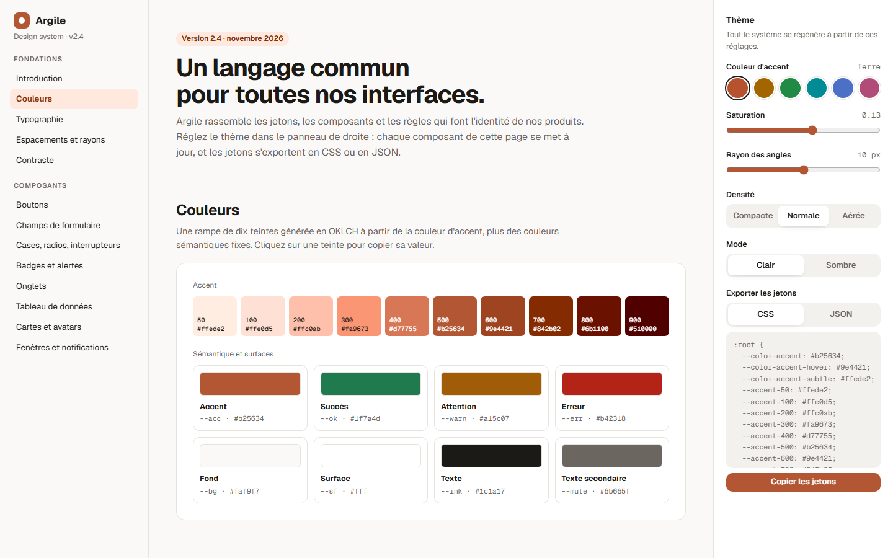
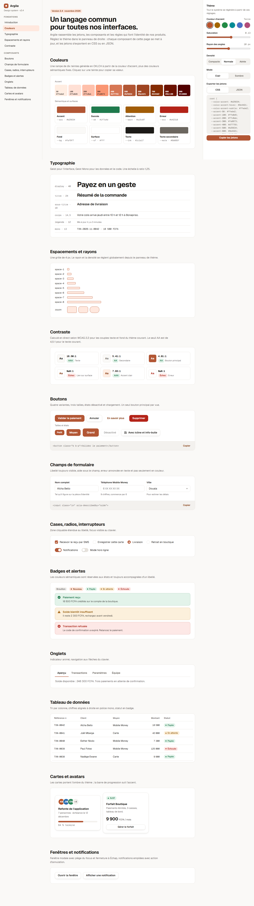
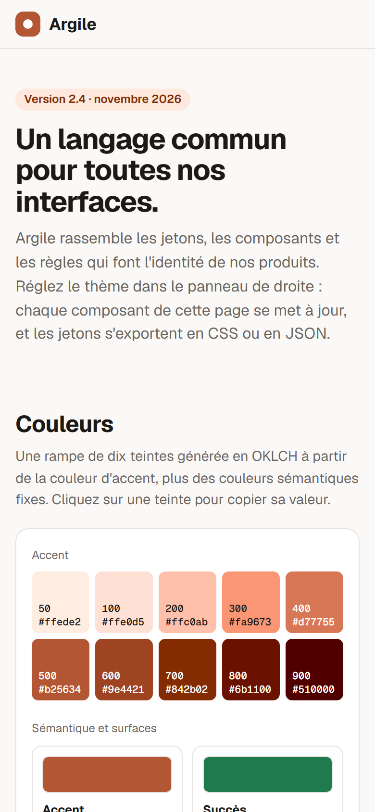

# Argile

**Design system et kit d'interface** — Documentation vivante d'un design system : rampe de couleurs générée en OKLCH à partir d'un seul accent, échelle typographique, espacements, rayons, et une quinzaine de composants accessibles. Un panneau de thème règle l'accent, la saturation, le rayon, la densité et le mode sombre ; le contraste WCAG se recalcule et les jetons s'exportent en variables CSS ou en JSON.

**Démo en ligne : [https://lordlennyx.github.io/argile-design-system/](https://lordlennyx.github.io/argile-design-system/)**

Spot de présentation (30 s) : [media/spot-30s.mp4](https://lordlennyx.github.io/argile-design-system/media/spot-30s.mp4)

## Ce que le projet montre

- Rampe de dix teintes générée en OKLCH, conversion sRGB et copie des valeurs au clic
- Thème en direct : accent, saturation, rayon, densité, mode clair ou sombre
- Contrôle de contraste WCAG 2.2 calculé sur les couples texte et fond du thème courant
- Composants : boutons (variantes, tailles, chargement), champs avec validation, cases, radios, interrupteurs, badges, alertes, onglets au clavier, tableau triable, cartes, avatars, modale avec piège du focus, notifications avec annulation
- Export des jetons en variables CSS ou en JSON, extraits de code copiables

## Réalisation

- **Stack :** HTML, CSS (OKLCH, color-mix, variables), JavaScript natif
- **Typographies :** Geist, Geist Mono
- **Évolutions possibles :** synchronisation avec les variables Figma, paquet npm de composants web, jetons au format Style Dictionary, tests d'accessibilité automatisés

| Bureau | Mobile |
|---|---|
|  |  |

---

Client et contenus fictifs, créés pour la démonstration. Conception, design et développement : **Njundiyimun Béchard** — [github.com/LordLennyx](https://github.com/LordLennyx)
